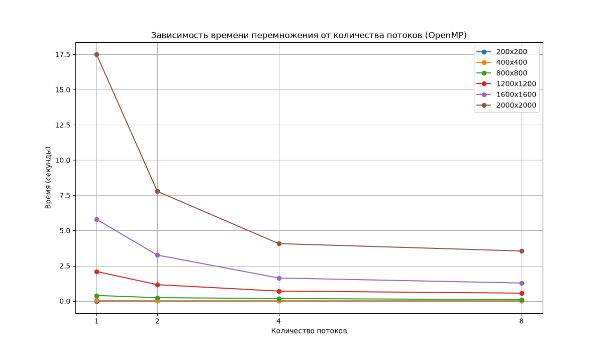

Лабораторная работа №2

Выполнил: Мурадова Ксения
Группа: 6213-100503

1. Постановка задачи
Модифицировать программу из л/р №1 для параллельной работы по технологии OpenMP. Провести серию экспериментов с разным количеством потоков (1, 2, 4, 8) и разными размерами матриц (200, 400, 800, 1200, 1600, 2000). Оценить эффективность распараллеливания.

3. Результаты экспериментов

| Размер | 1 поток | 2 потока | 4 потока | 8 потоков | Ускорение (1->8) |
| :--- | :--- | :--- | :--- | :--- | :--- |
| 200x200 | ... | ... | ... | ... | ... |
| 400x400 | ... | ... | ... | ... | ... |
| 800x800 | ... | ... | ... | ... | ... |
| 1200x1200 | ... | ... | ... | ... | ... |
| 1600x1600 | ... | ... | ... | ... | ... |
| 2000x2000 | ... | ... | ... | ... | ... |

4. График зависимости времени от количества потоков
Ниже представлен график, показывающий, как меняется время выполнения при увеличении количества потоков.

5. Выводы
В ходе работы была успешно применена технология OpenMP. Использование директивы распараллеливания позволило снизить время выполнения. Анализ таблицы и графика показывает, что с увеличением количества потоков время выполнения уменьшается. Однако, начиная с определенного момента (например, 4 или 8 потоков), ускорение замедляется из-за накладных расходов на синхронизацию потоков и ограничений пропускной способности памяти. Наибольшее ускорение достигается на больших матрицах.